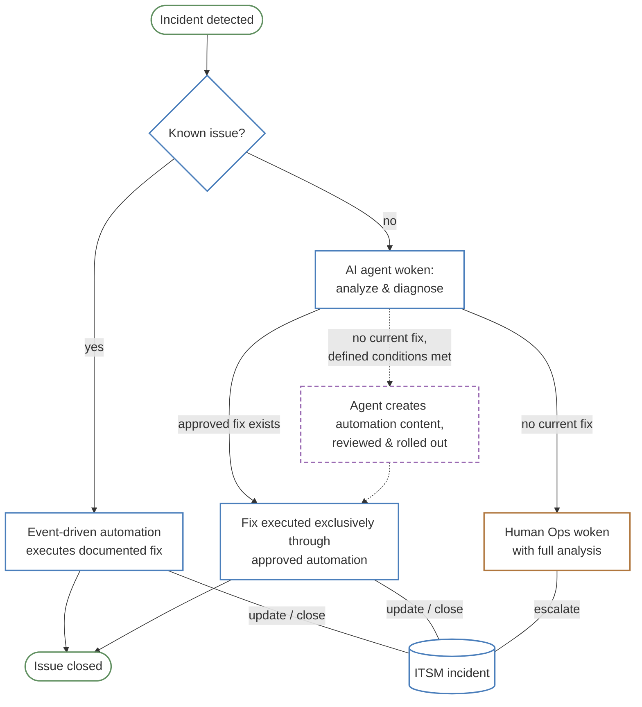
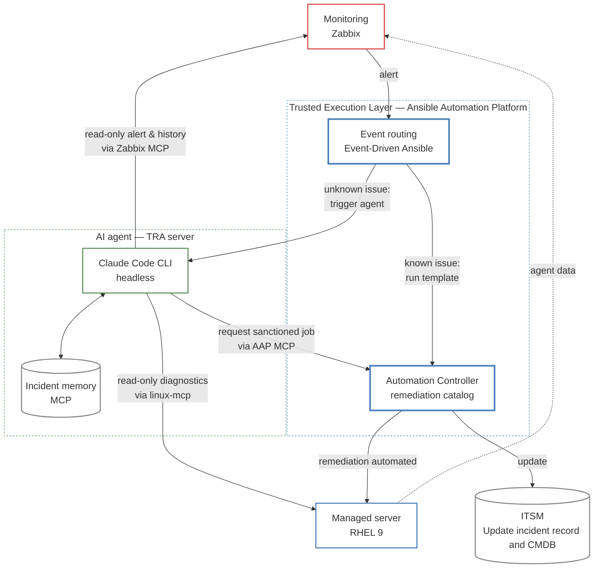

# AIOps self-healing demo

**[Open the interactive AIOps visualization](https://kvegh.github.io/aiops-selfhealing-demo/)**

AI-driven incident remediation for enterprise infrastructure — with the blast radius bounded by architecture, not by prompting.

> **This is a functionality demo, not a production reference architecture.** No attempt is made to follow least-privilege, security hardening, or production-grade guidelines. That is intentional — the goal is to demonstrate the architecture and the self-healing flow, not to provide a deployable solution.

## Interactive recovery walkthrough

**AAP is the Trusted Execution Layer.** Explore one presenter-paced recovery
story in [`demo/index.html`](demo/index.html): Zabbix detects a missing
`zabbix-agent2` package, EDA launches an AAP job that wakes an AI agent runtime,
the AI investigates all three systems through MCP and selects existing
automation, AAP executes **Deploy Zabbix Agent**, and monitoring confirms
recovery afterward. Job success and monitoring recovery are separate steps.

The self-contained frontend needs no live infrastructure, credentials, build,
or external assets. It includes keyboard navigation, reduced-motion support,
source previews, and a persistent architecture. This is a functionality
simulation; the walkthrough distinguishes AAP platform capabilities from the
agent instructions and hardening still to do. See the
[presenter, validation, and GitHub Pages guide](docs/12-interactive-recovery-walkthrough.md).
[Open the published visualization](https://kvegh.github.io/aiops-selfhealing-demo/).
GitHub Pages uses the included Actions workflow. Frontend release: **1.1.6**.
The palette uses a deep navy AAP platform with a thin red brand accent,
blue MCP paths, teal AI/execution accents, and labeled failure/recovery states.
**Ansible Automation Platform** is the large, bold platform title, alongside
its prominent **TRUSTED EXECUTION LAYER** role. The other components put
functionality first: **PROD SERVER**, **MONITORING**, and **AGENTIC AI**, with
smaller Red Hat Enterprise Linux, Zabbix in this case, and Claude in this case
captions. Codex, Copilot, and other runtimes
can represent the broader agent role; the current launcher remains Claude
Code CLI, and the visualization does not provision additional integrations.

## What this is

A reproducible demo in which infrastructure incidents are detected, diagnosed, and remediated automatically — including incidents nobody wrote a runbook for. An AI agent investigates the unknown cases and resolves them, yet at no point holds the ability to change systems directly: every change, without exception, runs through the organization's governed automation platform.

## The core idea

An incident is resolved at the lowest capable level. Known issues never wake the AI; the AI never acts outside approved automation; humans are woken with an analysis, not an alert.



Solid borders are the working demo. The dashed purple branch is **experimental** — the agent authoring new automation content is a research direction, not a shipped capability.

## Demo scenarios

**Stage 1 — self-healing a monitored host (Level 1)**

1. A package is removed from the managed host (`sudo dnf remove -y zabbix-agent2`), breaking monitoring
2. Zabbix detects agent unavailability after the configured timeout
3. Zabbix fires an alert via the Event-Driven Ansible media type to an EDA Event Stream
4. EDA rulebook matches the trigger name and launches an AAP job template
5. The job template invokes Claude Code CLI in headless mode
6. Claude investigates the host through Phase 1–4 (Zabbix MCP → linux-mcp → AAP MCP)
7. Claude identifies the missing package and launches the "Deploy Zabbix Agent" job template via AAP MCP
8. Zabbix confirms recovery after its check interval expires

The agent rule matches only a problem event (`event_value: 1`), with both name
and value present. The maintained Zabbix webhook converts the macro value to a
number before delivery; a recovery event does not launch the agent. See the
[monitoring and agent-readiness checks](docs/13-testserver-monitoring.md) before
enabling this separate flow on a fresh instance.

**Stage 2 — agent-authored remediation (Level 2)** — TBD

The agent generates Ansible playbook content to address an incident with no existing fix, then submits it for machine or human approval before execution.

## The four response levels

Every incident is handled at the lowest level capable of resolving it. Each level up grants the responding system more autonomy, accompanied by more controlling oversight:

- **Level 0** — deterministic runbooks
- **Level 1** — AI-driven diagnosis, constrained to approved remediations
- **Level 2** — agent-authored content under review
- **Level 3** — full human escalation

Which level handles an incident is not a runtime decision made on a whim; it is defined by policy and enforced by architecture.

**Level 0 — Known issue, known fix.**
The incident matches a documented pattern. A predefined remediation playbook executes deterministically through Event-Driven Ansible on AAP — fully audited, no AI involved. If the fix doesn't clear the issue, escalation to Level 1 is automatic.

**Level 1 — Unknown issue, known remediations.**
The incident doesn't match any documented pattern, or the known fix did not clear the issue. The AI agent is woken to investigate: it examines the affected systems read-only, correlates monitoring data with system state, and determines the cause — then resolves it strictly by selecting from the pre-approved remediation catalog. The agent reasons freely, but acts only within the approved catalog.

**Level 2 — Unknown issue, no fitting remediation.** *(experimental)*
The catalog holds no answer. The agent drafts a new remediation and submits it as a proposal — it never executes its own work. An independent second agent reviews for sanity and policy compliance before the proposal enters the catalog. Whether machine review suffices or a human gate is always required is an open question.

**Level 3 — Human escalation.**
Judgment is required beyond what any automation should exercise. The agent compiles the complete diagnostic picture — findings, attempted remediations, ruled-out causes — and wakes a human, who starts at the analysis rather than at a raw alert.

> **Management summary.** The bulk of incidents resolve at Level 0 — machine-speed, audit-grade, with no one paged at 3 a.m. The AI agent absorbs the long tail of unknowns at Level 1, working exclusively through the automation platform the organization already owns and governs — existing investment, extended rather than replaced. Escalations that do reach engineers arrive pre-analyzed, cutting time-to-resolution where expert time is scarcest. The AI agent's autonomy grows only as the remediation repertoire grows with it: new documented playbooks are added to the catalog, expanding what the agent can resolve — always through the same governed, auditable execution path.

## Component roles

These are the choices for this demo. Each role can be filled by other tools — the architecture depends on the roles, not the products.

| Role | This demo | Notes |
|------|-----------|-------|
| Monitoring & event source | Zabbix | Any monitoring system capable of forwarding events |
| Automation & orchestration — the Trusted Execution Layer | Ansible Automation Platform (AAP) incl. Event-Driven Ansible | Sole component that changes systems |
| Managed test server (monitored & remediated) | RHEL 9 | Stand-in for any managed fleet |
| Agent runtime server — tools, runtimes, admin (TRA) | RHEL 9 | Hosts the AI agent and its integration layer |
| AI agent | Claude Code (CLI, headless) | Any agentic LLM runtime with policy enforcement |

## Technical architecture



**Every arrow that changes state originates from the Trusted Execution Layer.** The AI agent has no direct write path anywhere.

> **Incident memory MCP** is shown in the diagram but not yet implemented.
> It is planned as a persistent knowledge graph for cross-incident learning —
> see [`docs/todo/demo-design.md`](docs/todo/demo-design.md#incident-memory-mcp).

## Guiding principles

- **The automation platform is strictly the only component that changes configurations or executes jobs.** It is the **Trusted Execution Layer**. LLMs are exceptionally creative — and exactly for that reason not reliable enough to follow operational policy unconditionally. Creativity belongs in diagnosis, never in execution.
- **All agent communication runs through defined integration interfaces (MCP)** — to monitoring, to the managed server, to the automation platform.
- **Read-only wherever possible.** The agent's interfaces to the managed server and to monitoring are read-only by construction, not by convention.
- **The agent operates under policy enforcement** that limits creative side activities outside operational policy — enforced in code, not requested in prompts.
- **Credentials never reach the agent.** AAP returns `$encrypted$` for all sensitive fields post-creation, enforces `no_log` protection even at maximum verbosity, and injects credentials into the execution environment only at runtime. The agent can launch a job template that uses credentials — it cannot read, extract, or exfiltrate them.

> **Management summary.** Control is not a promise made by the AI — it is a property of the architecture. The single governed execution path preserves every existing approval, audit, and compliance mechanism the organization already relies on. Adopting AI-driven operations this way carries no new class of privileged actor: the platform you already trust remains the only thing touching your systems.

## Repository layout

| Path | Content |
|---|---|
| [`docs/`](docs/) | Build/recreation guides (00 through 07), paused dashboard handoff (08), troubleshooting |
| [`docs/todo/`](docs/todo/) | Backlog and design notes |
| [`playbooks/`](playbooks/) | Remediation content and versioned website, monitoring and MCP deployment playbooks |
| [`assets/nginx/`](assets/nginx/) | Generic vhost example and panic-delivery cache snippets; private headers stay on the host |
| [`assets/zabbix/`](assets/zabbix/) | Green/red/grey status icons and portable map/dashboard request templates |
| [`src/`](src/) | Status-icon generator, stdio MCP verifier and unfinished AAP dashboard configuration helper/preprocessing |
| [`tests/`](tests/) | Deployment identity/artifact checks, MCP protocol checks, browser lifecycle and AAP dashboard preprocessing |
| [`extensions/eda/rulebooks/`](extensions/eda/rulebooks/) | EDA rulebooks (level routing) |
| [`AI_Instructions_Guardrails/`](AI_Instructions_Guardrails/) | Agent guardrails (CLAUDE.md) |

## Status

### CaC import and application launch

The reviewed capture defines eleven Job Templates and binds its inventory to the
selected instance's verified hypervisor, testserver and TRA. Importing it
creates AAP configuration and launches no application or EDA activation.
Secret-dependent jobs receive a whole-file Vault ciphertext string and stop
before managed host, DNS or API writes when required settings are missing.
The [protected runtime settings procedure](docs/11-protected-runtime-settings.md)
uses the existing private AIOps repository and runtime Vault credential.
Application launch is a separate readiness step.

At launch, select the AAP inventory entry by its inventory name. The private
capture uses that entry's `vm_resource.vm_name` to select saved AIOps guest and
runtime settings. An inventory alias can therefore change while the existing
VM name, public FQDN, tokens and runtime ciphertext remain unchanged. Inventory
facts still come from the entry selected through `aap_instance_key`.

### Claude and MCP deployment for a new TRA

**Deploy Claude and MCP Servers** runs `playbooks/deploy_claude.yml`. It installs
the reviewed native Claude release through the execution environment, provisions
only the explicitly approved encrypted Vertex authentication and reuses both MCP
playbooks below. It verifies the actual job user's command/version, preserves
existing workspace instructions and unrelated settings, and performs no model
request or activation. See the [Claude deployment procedure](docs/14-claude-deployment.md)
for ownership/conflict checks, the shared workspace override and the separate
functional checks. The installer also configures the selected private AAP MCP
using the existing API/MCP token and application-scoped CA. The bounded runner
permits only the checked saved agent repair and requires native child-job,
service and fresh monitoring recovery checks. The agent and integration guides
link to this executable procedure. A supported recovery requires at
least one actual saved repair job; model prose cannot substitute for it.
The runner reads its own native Controller job to obtain the project ID;
Controller's injected inventory and job IDs are checked against that record.
It does not require a nonexistent injected project-ID variable.

The existing production SCM Project retains an owner-approved tested-commit
pin until its runtime is deliberately migrated. Shared desired CaC stays on
`main`; see the [production migration boundary](docs/14-claude-deployment.md#preserve-the-existing-production-runner-during-migration).

The two requested MCP deployment jobs use
`playbooks/deploy_linux_mcp.yml` and `playbooks/deploy_zabbix_mcp.yml`. They
preserve the existing on-demand Podman/stdio configuration, connect only to the
matching new testserver and Zabbix instance, and configure the existing TRA user.
See the [MCP deployment procedure](docs/10-mcp-deployment.md) for the verified
guest metadata, signed offline runtime/image staging and read-only checks.
The RPM manifest must contain the install set validated against the selected
guest, including its conditional SELinux dependencies; the procedure explains
the required dependency solve before installation.
They create no public MCP listener and do not install or invoke Claude Code.
Those two standalone MCP jobs remain available; Claude installation is added by
the combined entry point above.
Delegated testserver SSH connections read the computed address, user, port and
temporary trust-file path from the original TRA host. The Zabbix deployment
publishes its verified machine, disk, network and SSH identities for later MCP
configuration and guarded cleanup.
The Zabbix MCP invocation maps the existing TRA user to the saved image's
non-root identity so its private, read-only configuration stays accessible.
Its verifier JSON-decodes the count after the server's unchanged safety warning
and still rejects errors or nonnumeric results.
The Zabbix clone places its own hostname first in the owned hosts-file entry
for the versioned proxy URLs, and retries repair that entry before checking its
fully qualified hostname.
Its public frontend readiness check retries within a bounded window while
requiring trusted HTTPS, HTTP 401 and the expected Basic authentication
challenge. A persistent failure stops deployment.

Monitoring deployment reconciles copied hostnames, check labels and URLs to
the selected instance while retaining record IDs and history. It removes stale
EDA recipient destinations and clears disabled dashboard credentials. The
selected website and agent forwarding actions stay disabled until frontend and exact
configuration readbacks pass, then the existing delivery flag can enable them as
the final configuration writes. The agent action matches only the verified
testserver's agent-availability trigger and shares the current target Event
Stream media. Other copied hosts and actions stay disabled.
An explicit per-instance opt-in can also enable the verified testserver's Linux
and ICMP monitoring after its agent is installed. The normal deployment checks
the actual domain/lease and agent identity before stopping monitoring, keeps
inapplicable Apache checks disabled without deleting their history, and requires
fresh agent ping, uptime and ICMP samples before finishing. The agent action is
configured only when that testserver monitoring is requested. Setup enables no
Claude rulebook activation and runs no model or fault. See
[selected testserver monitoring](docs/13-testserver-monitoring.md).

Both new MCP installations have completed their normal jobs and passed real
read-only queries against their matching testserver and monitoring instance.
The normal Zabbix deployment has also succeeded, with independently
verified clone authentication, quarantine and trusted public HTTPS protection.
The normal website deployment has also succeeded: versioned DNS, trusted HTTPS,
content and the selected new AAP webhook were independently verified. Subsequent
target-local monitoring reconciliation passed a complete normal fault-job test:
Zabbix delivered the problem and recovery events, EDA ran the existing restore
and rearm templates, and content and arm endpoints returned HTTP 200 again.
The deployment code and matching private CaC have been published. The initial
live reconciliation used the reviewed helper through the existing authenticated
API; a subsequent normal monitoring deployment job also passed on that published
revision. Independent readbacks confirmed idempotent reconciliation, selected
forwarding, preserved website activation and healthy content and arm endpoints.

The existing Zabbix agent job also passed on the verified new test guest after
its CaC project reference was corrected and package-download HTTPS was approved.
The matching monitoring VM received a successful passive agent ping. Successful
guest configuration now releases only that guest's extra recovery isolation,
while production destinations remain blocked. Selected monitoring has its own
explicit readiness check and configuration switch; a live AI-remediation
rehearsal remains separate from installing the agent or collecting healthy data.
The selected testserver has now passed both a normal monitoring deployment and
a normal repeat. Independent readbacks confirmed fresh agent ping, uptime and
ICMP data, retained host/check identities, disabled Apache checks and unchanged
website delivery with healthy content and arm endpoints. General Claude
activation remains disabled; no model inference or new outage was invoked.

### Audience website lifecycle

For a new versioned recovery deployment, use the
[versioned website procedure](docs/09-versioned-website-deployment.md).
The existing **Enable Demo Website** job can provision DNS, trusted HTTPS and
its nginx virtual host on the hypervisor selected for the AAP instance. Both
`aap27.vNN.<zone>` and `redhat.vNN.<zone>` reuse that instance's existing
allocation number. Content, its staged checkout, nginx configuration and
delivery-cache paths are separate for each version. Hypervisor SSH keys and
machine identity are pinned; there is no production address or hostname fallback
in this mode.

The initial recovery capture disables website monitoring changes, shared
fail2ban changes and button arming. The site can be deployed and checked while
the button stays disarmed and EDA activation definitions stay disabled.
Target-local monitoring and automatic repair must be configured before enabling
the complete audience outage/recovery loop. The deployment uses an existing
approved ACME account and base-installed packages; it accepts no legal terms
and installs no dependencies.

After the CaC import, the selected target's fault-template ID and generated
webhook key can be read through its authenticated HTTPS API. The DNS and webhook
inputs stay in the private whole-file runtime Vault, organized by selected
instance. The CaC capture saves only that file's unchanged ciphertext on the
existing application templates. Native `include_vars` decrypts it in the
execution environment and always removes its private temporary file.
Controller does not support the earlier proposed inline Vault launch scalars
or JSON Vault-marker mappings. No custom decoder, credential type or store has
been introduced.

The focused runtime checks cover scalar and structured credentials, literal
credential text, wrong instances/keys, protected output and cleanup on failure:

```bash
ANSIBLE_LOCAL_TEMP=/tmp/aiops-runtime-tests python3.12 -m unittest discover -s tests -p test_runtime_settings.py -v
```

The following lifecycle instructions describe an existing host whose virtual
host is already configured. That mode retains its current defaults.

Use [the recreation guide](docs/07-audience-website-demo.md) for the complete
nginx, firewall, Zabbix, Vault, controller, and EDA setup and today's test evidence.

The **Enable Demo Website** and **Disable Demo Website** templates share
`playbooks/demo_website.yml`, with `demo_website_state` pinned to `enabled`
or `disabled`. Enable serves and arms the audience page, stops the demo's
fail2ban jail, and removes nginx rate limiting for the entire demo site.
Disable serves the placeholder, disarms the button, restores the jail,
and restores the button's previous limit of two requests per minute per
non-exempt client IP, with one additional burst request. Page loads and
polling have no rate limit in either state. Other virtual hosts are unaffected.

The host-owned demo vhost must define its dedicated `redhat_panic` zone
using its existing client exemption map and include the following inside
the exact `/api/panic` location, replacing the inline rate-limit directives:

```nginx
include /etc/nginx/demo-website-rate-limit.conf;
```

Create that include before running the templates. Its default disabled
contents are:

```nginx
limit_req zone=redhat_panic burst=1 nodelay;
limit_req_status 429;
```

Use `demo_website_rate_limit_file` to override the include path if needed.
Keep the server-side arm-marker guard and webhook forwarding in the vhost;
the lifecycle playbook does not replace that configuration or handle its
secret. The rate-limit file contains no credentials. Its directives use
literal YAML newlines so each occupies its own line. Host-specific addresses
and credentials belong in inventory or encrypted configuration.

The enable/disable, content-restore and button-rearm playbooks use
`demo_website_public_hostname` for their HTTPS checks. Its default is the
existing production hostname, now stored as `vault_demo_website_public_hostname`
in the encrypted project-root `myvars`. Inventory or job extra variables can
select a different hostname, such as `demo.test.example.com`. Both TLS SNI and
the URL use that hostname while connecting to loopback; certificate verification,
HTTP status checks and the demo lifecycle are retained.

Before deploying this revision, attach the existing project Vault credential
to **Restore Website Content** and **Arm Demo Button**, as well as Enable and
Disable. The restore and rearm playbooks now load `myvars` too. Make this
credential association before syncing the new revision into a live project.
The source change does not itself sync AAP or alter its deployed templates.

On 2026-10-30, the existing project Vault credential was associated with the
existing Restore Website Content and Arm Demo Button templates and read back.
Their machine credentials were retained. This prepares the existing deployment
for the hostname revision on `main`; it does not prove a test-host recovery.
New cloned deployments must still attach the credential before using the code.

Each changed include is validated with `nginx -t`, followed by a reload
and a check for new worker processes. A failed change restores the previous
include and fails the job. Changing a live shared-memory zone's key requires
a new zone name or a restart; a successful reload command alone does not
prove nginx accepted the change.

Validate locally with the existing Ansible toolchain; no new dependencies:

```bash
ansible-playbook --syntax-check --vault-password-file /path/to/vault-password -i localhost, playbooks/demo_website.yml
ansible-playbook --syntax-check --vault-password-file /path/to/vault-password -i localhost, playbooks/restore_website_content.yml
ansible-playbook --syntax-check --vault-password-file /path/to/vault-password -i localhost, playbooks/arm_demo_button.yml
ANSIBLE_LOCAL_TEMP=/tmp/aiops-hostname-local python3.12 -m unittest discover -s tests -p test_website_hostname.py -v
python3.12 -m unittest discover -s tests -p test_versioned_website.py -v
node tests/browser_polling.test.js
ansible-lint playbooks/tasks/demo_website_rate_limit.yml
git diff --check
```

Validate deployed behavior by running Disable and Enable in AAP and checking
the include's contents, worker replacement, and each template's HTTP check.
Keep the final demo state appropriate for the next session.

Simultaneous presses also require the static nginx delivery-cache snippets in
`assets/nginx/`. AAP's sequential webhook deduplication allowed a live
concurrency race; nginx now locks delivery by POST body and shares the accepted
202 response. Each arming has a fresh nonce, so the next round is independent.
The ten-press rounds each produced one fault job after this fix. Keep the arm
guard and private webhook headers when installing the snippets; the recreation
guide has the required paths and checks.

The deployed Disable → Enable → Disable sequence passed after the newline
fix. Each state was checked for the expected rate-limit include, page and
arm-status HTTP responses, and demo fail2ban jail state. The initial malformed
include test also exercised automatic rollback successfully. The local
syntax check passed; the separate local lint launcher could not import Ansible.

### Website monitoring and repair

The audience button launches **Simulate Website Outage**, whose description
is **Inject Website Fault**. The template keeps its existing ID and
`playbooks/inject_website_fault.yml` path. Renaming it requires no change to
nginx's ID-based webhook URL or to the repair/rearm rulebook.

The website host has a static, source-restricted firewalld rule allowing the
monitoring VM to reach TCP 443 through its VM-facing zone. This is one-time
host networking setup, not a demo job template. Keep the monitoring address
out of this repository.

`extensions/eda/rulebooks/demo-website-restore.yml` matches the dedicated
website-content Zabbix problem event on the existing Event Stream and launches
the existing **Restore Website Content** job template. Its trigger name is
`Demo website content unavailable`. A separate Zabbix action restricted to
that trigger sends the recovery event to the same stream. The rulebook routes
only the problem event to repair and only the recovery event to **Arm Demo
Button**. That job confirms the content is still served, then writes a fresh
nonce. Waiting for the recovered Zabbix state prevents a rapid second press
from arriving while the original problem is still open. The web check should
be active only during an enabled demo, so the intentionally disabled site does
not generate a repair event.
The Zabbix HTTP check runs every **four seconds** for faster detection and
recovery confirmation.

For a continuous green → red → green display, open **Monitoring → Maps →
Big Bad Button - Live Website**. This private presenter map links its green,
red, and grey icons to the website trigger's healthy, problem, and disabled
states. The presenter's frontend refresh is four seconds. The Problems list
can show only recovery if its display refresh misses the short outage; the
trigger configuration table is not the live presentation view. The website
host's visible name is its website hostname, so it is easy to identify under
**Monitoring → Hosts**. Its HTTP check uses the Problems column rather than a
Zabbix-agent availability indicator.

The recreation guide includes the map and frontend settings. Regenerate its
PNG icons and matching SVG sources using Python's standard library:

```bash
python3 src/generate_status_icons.py
```

To show new notifications sent to EDA, open **Dashboards → Big Bad Button -
EDA Deliveries**. Its private Action log widget refreshes every ten seconds,
shows five entries newest first, and uses a rolling five-minute window with
the existing action and media-type filters. The original two-widget dashboard
combined the green/red/grey health map with the delivery log. The unfinished
extension adds an EDA event counter and recent/running BBB job panels; its
metrics were blocked by AAP certificate trust at the last live check.
All dashboard widgets refresh every ten seconds. See the
[dashboard handoff](docs/08-aap-monitoring-handoff.md) before changing or
recreating this extended configuration. Reports → Action log needs
a manual refresh; the standalone health map remains available for faster
four-second updates. The [recreation guide](docs/07-audience-website-demo.md#show-live-deliveries-to-eda)
and [dashboard request template](assets/zabbix/website-deliveries-dashboard.json.j2)
record the setup.

Zabbix sends the event value as a number (`1` for problem, `0` for recovery).
The rule conditions use numeric comparisons; comparing these values with
quoted strings causes an EDA rule-evaluation error and prevents repair.

The live automatic loop passed twice in succession: fault jobs 1537 and 1543,
repair jobs 1539 and 1545, and recovery-driven arm jobs 1541 and 1547 all
succeeded. Both problem and recovery notifications were delivered successfully.
The shell polls content and arm state every two seconds, so open browsers
show failure, recovery, and the rearmed button without a page refresh.
The outage view displays a large **OMG, PANIC, it is KAPUTT!!!** message
and retains the detection timestamp.

The Zabbix media script needs the Event Stream endpoint, Basic Auth header,
and recovery-event validation documented in
[the integration guide](docs/06-eda-zabbix-integration.md#update-media-type-parameters-for-event-streams).
Preserve these changes when redeploying the media type.

**Enable Demo Website**, **Disable Demo Website**, **Restore Website Content**
and **Arm Demo Button** load the project-root `myvars`, an Ansible Vault-encrypted
file containing the production website hostname default and these lifecycle
monitoring settings:

- `vault_demo_website_public_hostname`
- `demo_zabbix_api_url`
- `demo_zabbix_api_token`
- `demo_zabbix_item_id`
- `demo_zabbix_trigger_id`

The same encrypted file now also holds the unfinished dashboard's AAP
read token and integration settings. The [handoff](docs/08-aap-monitoring-handoff.md#encrypted-settings)
lists their names without disclosing their values.

Attach the existing Vault credential to all four templates alongside their machine
credential. The standalone AAP project cannot read the parent repo's shared
Vault file. Edit this project's file with `ansible-vault edit myvars` using
the existing password file; never commit a decrypted copy.

Disable disarms the button and disables the trigger and item before removing
content. Enable holds the button disarmed, deploys and verifies the content,
resumes sampling, waits for a fresh Zabbix 200, enables the trigger, and finally
arms the button. A monitoring API failure fails the job with protected logging.
The final Disable (1581) → Enable (1583) → two ten-press rounds → Disable
(1597) rehearsal passed. The rounds produced exactly one fault/repair/rearm
chain each: 1585/1587/1589 and 1591/1593/1595. All twenty concurrent requests
returned 202, and late presses while disarmed returned the expected 423.
Zabbix delivered both problem and recovery notifications for each round, and
EDA logs confirmed all repair and rearm launches. Final checks found the
placeholder at 200, content and arm endpoints at 404, panic at 423, monitoring
disabled, rate limiting restored, and the fail2ban jail running.

### Paused AAP dashboard extension

The working website fault → Zabbix → EDA repair → recovery-driven rearm loop
remains the baseline. The user cancelled the proposed extra ten-second pause;
it was removed locally before deployment, and the repair playbook is unchanged.
The user reported successful live operation with its existing timing.

Resume the unfinished Event Stream count and BBB-only job monitoring from
[the dated handoff](docs/08-aap-monitoring-handoff.md). It records the prepared
files, last observed certificate-trust blocker, safe configuration command,
local validation, and remaining live verification. This checkpoint does not
claim that the new metrics are collecting data or that a new end-to-end test
has passed.

Working demo; documentation in progress. Failure modes and design decisions are documented deliberately — real behavior over polished success.

Pull requests are welcome. For questions or ideas, open a [GitHub Issue](https://github.com/kvegh/aiops-selfhealing-demo/issues) or reach out via [GitHub](https://github.com/kvegh).
