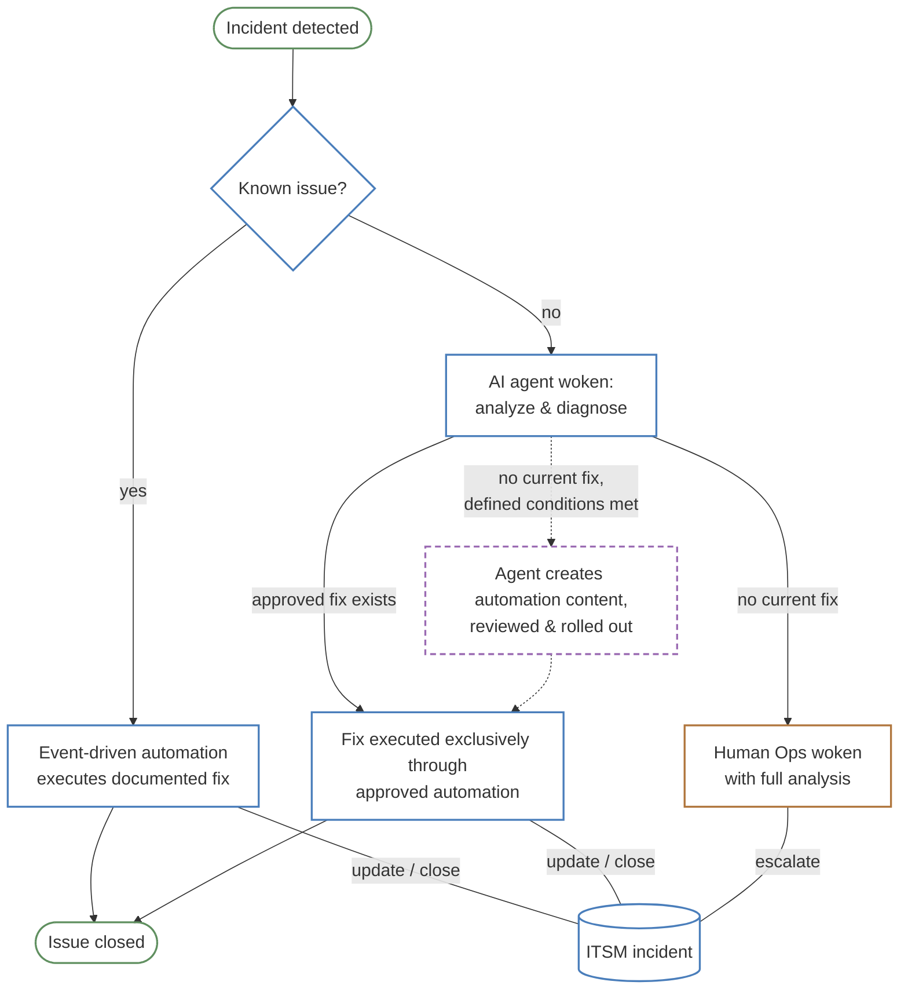
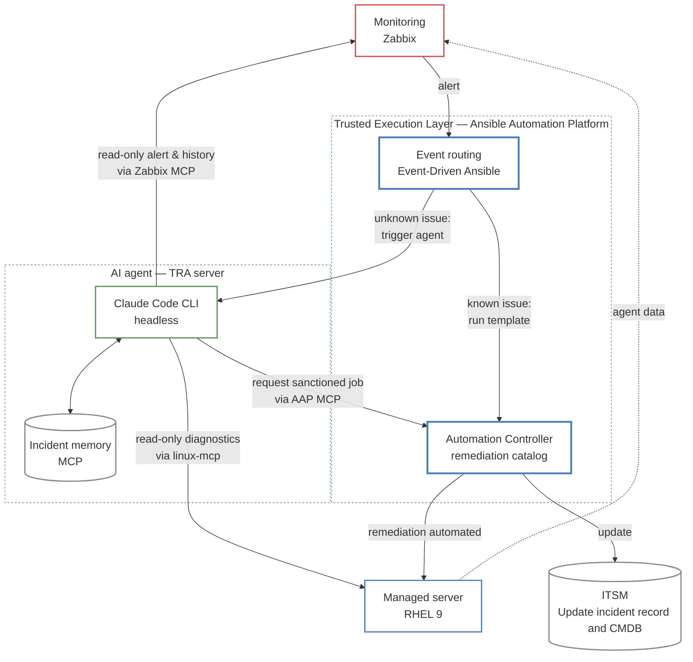

# AIOps self-healing demo

AI-driven incident remediation for enterprise infrastructure — with the blast radius bounded by architecture, not by prompting.

> **This is a functionality demo, not a production reference architecture.** No attempt is made to follow least-privilege, security hardening, or production-grade guidelines. That is intentional — the goal is to demonstrate the architecture and the self-healing flow, not to provide a deployable solution.

## What this is

A reproducible demo in which infrastructure incidents are detected, diagnosed, and remediated automatically — including incidents nobody wrote a runbook for. An AI agent investigates the unknown cases and resolves them, yet at no point holds the ability to change systems directly: every change, without exception, runs through the organization's governed automation platform.

## The core idea

An incident is resolved at the lowest capable level. Known issues never wake the AI; the AI never acts outside approved automation; humans are woken with an analysis, not an alert.



Solid borders are the working demo. The dashed purple branch is **experimental** — the agent authoring new automation content is a research direction, not a shipped capability.

## Demo scenarios

**Stage 1 — self-healing a monitored host (Level 1)**

1. A package is removed from the managed host (`sudo dnf remove -y zabbix-agent2`), breaking monitoring
2. Zabbix detects agent unavailability after the configured timeout
3. Zabbix fires an alert via the Event-Driven Ansible media type to an EDA Event Stream
4. EDA rulebook matches the trigger name and launches an AAP job template
5. The job template invokes Claude Code CLI in headless mode
6. Claude investigates the host through Phase 1–4 (Zabbix MCP → linux-mcp → AAP MCP)
7. Claude identifies the missing package and launches the "Deploy Zabbix Agent" job template via AAP MCP
8. Zabbix confirms recovery after its check interval expires

**Stage 2 — agent-authored remediation (Level 2)** — TBD

The agent generates Ansible playbook content to address an incident with no existing fix, then submits it for machine or human approval before execution.

## The four response levels

Every incident is handled at the lowest level capable of resolving it. Each level up grants the responding system more autonomy, accompanied by more controlling oversight:

- **Level 0** — deterministic runbooks
- **Level 1** — AI-driven diagnosis, constrained to approved remediations
- **Level 2** — agent-authored content under review
- **Level 3** — full human escalation

Which level handles an incident is not a runtime decision made on a whim; it is defined by policy and enforced by architecture.

**Level 0 — Known issue, known fix.**
The incident matches a documented pattern. A predefined remediation playbook executes deterministically through Event-Driven Ansible on AAP — fully audited, no AI involved. If the fix doesn't clear the issue, escalation to Level 1 is automatic.

**Level 1 — Unknown issue, known remediations.**
The incident doesn't match any documented pattern, or the known fix did not clear the issue. The AI agent is woken to investigate: it examines the affected systems read-only, correlates monitoring data with system state, and determines the cause — then resolves it strictly by selecting from the pre-approved remediation catalog. The agent reasons freely, but acts only within the approved catalog.

**Level 2 — Unknown issue, no fitting remediation.** *(experimental)*
The catalog holds no answer. The agent drafts a new remediation and submits it as a proposal — it never executes its own work. An independent second agent reviews for sanity and policy compliance before the proposal enters the catalog. Whether machine review suffices or a human gate is always required is an open question.

**Level 3 — Human escalation.**
Judgment is required beyond what any automation should exercise. The agent compiles the complete diagnostic picture — findings, attempted remediations, ruled-out causes — and wakes a human, who starts at the analysis rather than at a raw alert.

> **Management summary.** The bulk of incidents resolve at Level 0 — machine-speed, audit-grade, with no one paged at 3 a.m. The AI agent absorbs the long tail of unknowns at Level 1, working exclusively through the automation platform the organization already owns and governs — existing investment, extended rather than replaced. Escalations that do reach engineers arrive pre-analyzed, cutting time-to-resolution where expert time is scarcest. The AI agent's autonomy grows only as the remediation repertoire grows with it: new documented playbooks are added to the catalog, expanding what the agent can resolve — always through the same governed, auditable execution path.

## Component roles

These are the choices for this demo. Each role can be filled by other tools — the architecture depends on the roles, not the products.

| Role | This demo | Notes |
|------|-----------|-------|
| Monitoring & event source | Zabbix | Any monitoring system capable of forwarding events |
| Automation & orchestration — the Trusted Execution Layer | Ansible Automation Platform (AAP) incl. Event-Driven Ansible | Sole component that changes systems |
| Managed test server (monitored & remediated) | RHEL 9 | Stand-in for any managed fleet |
| Agent runtime server — tools, runtimes, admin (TRA) | RHEL 9 | Hosts the AI agent and its integration layer |
| AI agent | Claude Code (CLI, headless) | Any agentic LLM runtime with policy enforcement |

## Technical architecture



**Every arrow that changes state originates from the Trusted Execution Layer.** The AI agent has no direct write path anywhere.

> **Incident memory MCP** is shown in the diagram but not yet implemented.
> It is planned as a persistent knowledge graph for cross-incident learning —
> see [`docs/todo/demo-design.md`](docs/todo/demo-design.md#incident-memory-mcp).

## Guiding principles

- **The automation platform is strictly the only component that changes configurations or executes jobs.** It is the **Trusted Execution Layer**. LLMs are exceptionally creative — and exactly for that reason not reliable enough to follow operational policy unconditionally. Creativity belongs in diagnosis, never in execution.
- **All agent communication runs through defined integration interfaces (MCP)** — to monitoring, to the managed server, to the automation platform.
- **Read-only wherever possible.** The agent's interfaces to the managed server and to monitoring are read-only by construction, not by convention.
- **The agent operates under policy enforcement** that limits creative side activities outside operational policy — enforced in code, not requested in prompts.
- **Credentials never reach the agent.** AAP returns `$encrypted$` for all sensitive fields post-creation, enforces `no_log` protection even at maximum verbosity, and injects credentials into the execution environment only at runtime. The agent can launch a job template that uses credentials — it cannot read, extract, or exfiltrate them.

> **Management summary.** Control is not a promise made by the AI — it is a property of the architecture. The single governed execution path preserves every existing approval, audit, and compliance mechanism the organization already relies on. Adopting AI-driven operations this way carries no new class of privileged actor: the platform you already trust remains the only thing touching your systems.

## Repository layout

| Path | Content |
|---|---|
| [`docs/`](docs/) | Build guide (00 through 06), troubleshooting |
| [`docs/todo/`](docs/todo/) | Backlog and design notes |
| [`playbooks/`](playbooks/) | AAP project content used by the remediation templates |
| [`assets/nginx/`](assets/nginx/) | Generic vhost example and panic-delivery cache snippets; private headers stay on the host |
| [`extensions/eda/rulebooks/`](extensions/eda/rulebooks/) | EDA rulebooks (level routing) |
| [`AI_Instructions_Guardrails/`](AI_Instructions_Guardrails/) | Agent guardrails (CLAUDE.md) |

## Status

### Audience website lifecycle

Use [the recreation guide](docs/07-audience-website-demo.md) for the complete
nginx, firewall, Zabbix, Vault, controller, and EDA setup and today's test evidence.

The **Enable Demo Website** and **Disable Demo Website** templates share
`playbooks/demo_website.yml`, with `demo_website_state` pinned to `enabled`
or `disabled`. Enable serves and arms the audience page, stops the demo's
fail2ban jail, and removes nginx rate limiting for the entire demo site.
Disable serves the placeholder, disarms the button, restores the jail,
and restores the button's previous limit of two requests per minute per
non-exempt client IP, with one additional burst request. Page loads and
polling have no rate limit in either state. Other virtual hosts are unaffected.

The host-owned demo vhost must define its dedicated `redhat_panic` zone
using its existing client exemption map and include the following inside
the exact `/api/panic` location, replacing the inline rate-limit directives:

```nginx
include /etc/nginx/demo-website-rate-limit.conf;
```

Create that include before running the templates. Its default disabled
contents are:

```nginx
limit_req zone=redhat_panic burst=1 nodelay;
limit_req_status 429;
```

Use `demo_website_rate_limit_file` to override the include path if needed.
Keep the server-side arm-marker guard and webhook forwarding in the vhost;
the lifecycle playbook does not replace that configuration or handle its
secret. The rate-limit file contains no credentials. Its directives use
literal YAML newlines so each occupies its own line. Host-specific addresses
and credentials belong in inventory or encrypted configuration.

Each changed include is validated with `nginx -t`, followed by a reload
and a check for new worker processes. A failed change restores the previous
include and fails the job. Changing a live shared-memory zone's key requires
a new zone name or a restart; a successful reload command alone does not
prove nginx accepted the change.

Validate locally with the existing Ansible toolchain; no new dependencies:

```bash
ansible-playbook --syntax-check --vault-password-file /path/to/vault-password -i localhost, playbooks/demo_website.yml
node tests/browser_polling.test.js
ansible-lint playbooks/tasks/demo_website_rate_limit.yml
git diff --check
```

Validate deployed behavior by running Disable and Enable in AAP and checking
the include's contents, worker replacement, and each template's HTTP check.
Keep the final demo state appropriate for the next session.

Simultaneous presses also require the static nginx delivery-cache snippets in
`assets/nginx/`. AAP's sequential webhook deduplication allowed a live
concurrency race; nginx now locks delivery by POST body and shares the accepted
202 response. Each arming has a fresh nonce, so the next round is independent.
The ten-press rounds each produced one fault job after this fix. Keep the arm
guard and private webhook headers when installing the snippets; the recreation
guide has the required paths and checks.

The deployed Disable → Enable → Disable sequence passed after the newline
fix. Each state was checked for the expected rate-limit include, page and
arm-status HTTP responses, and demo fail2ban jail state. The initial malformed
include test also exercised automatic rollback successfully. The local
syntax check passed; the separate local lint launcher could not import Ansible.

### Website monitoring and repair

The website host has a static, source-restricted firewalld rule allowing the
monitoring VM to reach TCP 443 through its VM-facing zone. This is one-time
host networking setup, not a demo job template. Keep the monitoring address
out of this repository.

`extensions/eda/rulebooks/demo-website-restore.yml` matches the dedicated
website-content Zabbix problem event on the existing Event Stream and launches
the existing **Restore Website Content** job template. Its trigger name is
`Demo website content unavailable`. A separate Zabbix action restricted to
that trigger sends the recovery event to the same stream. The rulebook routes
only the problem event to repair and only the recovery event to **Arm Demo
Button**. That job confirms the content is still served, then writes a fresh
nonce. Waiting for the recovered Zabbix state prevents a rapid second press
from arriving while the original problem is still open. The web check should
be active only during an enabled demo, so the intentionally disabled site does
not generate a repair event.
The Zabbix HTTP check runs every **four seconds** for faster detection and
recovery confirmation.

Zabbix sends the event value as a number (`1` for problem, `0` for recovery).
The rule conditions use numeric comparisons; comparing these values with
quoted strings causes an EDA rule-evaluation error and prevents repair.

The live automatic loop passed twice in succession: fault jobs 1537 and 1543,
repair jobs 1539 and 1545, and recovery-driven arm jobs 1541 and 1547 all
succeeded. Both problem and recovery notifications were delivered successfully.
The shell polls content and arm state every two seconds, so open browsers
show failure, recovery, and the rearmed button without a page refresh.
The outage view displays a large **OMG, PANIC, it is KAPUTT!!!** message
and retains the detection timestamp.

The Zabbix media script needs the Event Stream endpoint, Basic Auth header,
and recovery-event validation documented in
[the integration guide](docs/06-eda-zabbix-integration.md#update-media-type-parameters-for-event-streams).
Preserve these changes when redeploying the media type.

**Enable Demo Website** and **Disable Demo Website** load the project-root
`myvars`, an Ansible Vault-encrypted file containing only these monitoring
settings:

- `demo_zabbix_api_url`
- `demo_zabbix_api_token`
- `demo_zabbix_item_id`
- `demo_zabbix_trigger_id`

Attach the existing Vault credential to both templates alongside their machine
credential. The standalone AAP project cannot read the parent repo's shared
Vault file. Edit this project's file with `ansible-vault edit myvars` using
the existing password file; never commit a decrypted copy.

Disable disarms the button and disables the trigger and item before removing
content. Enable holds the button disarmed, deploys and verifies the content,
resumes sampling, waits for a fresh Zabbix 200, enables the trigger, and finally
arms the button. A monitoring API failure fails the job with protected logging.
The final Disable (1581) → Enable (1583) → two ten-press rounds → Disable
(1597) rehearsal passed. The rounds produced exactly one fault/repair/rearm
chain each: 1585/1587/1589 and 1591/1593/1595. All twenty concurrent requests
returned 202, and late presses while disarmed returned the expected 423.
Zabbix delivered both problem and recovery notifications for each round, and
EDA logs confirmed all repair and rearm launches. Final checks found the
placeholder at 200, content and arm endpoints at 404, panic at 423, monitoring
disabled, rate limiting restored, and the fail2ban jail running.

Working demo; documentation in progress. Failure modes and design decisions are documented deliberately — real behavior over polished success.

Pull requests are welcome. For questions or ideas, open a [GitHub Issue](https://github.com/kvegh/aiops-selfhealing-demo/issues) or reach out via [GitHub](https://github.com/kvegh).
